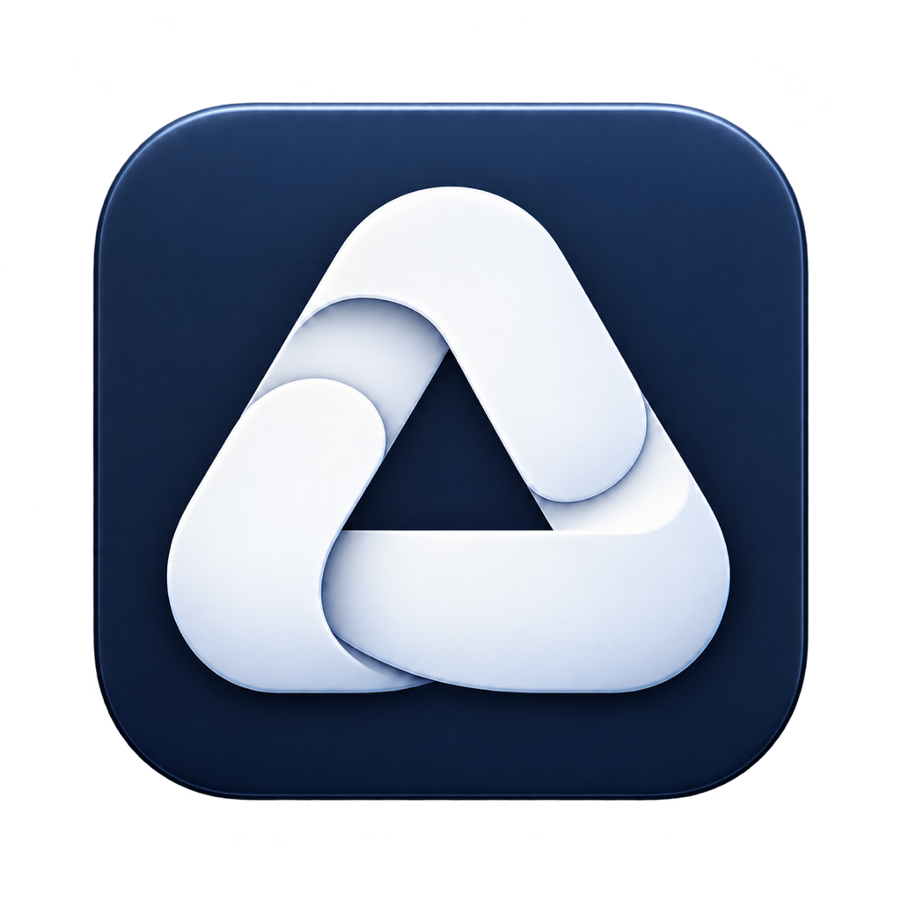

<p align="center">
  
</p>

<h1 align="center">AgentCrew</h1>

<p align="center">A local desktop workspace for AI agents that carry work through to completion.</p>

<p align="center"><strong>macOS · Apple Silicon · Electron + Python</strong></p>

<p align="center">English · <a href="README.zh-CN.md">简体中文</a></p>

AgentCrew brings task execution, human approvals, persistent memory, and scheduled work into one desktop application. Give an agent a task, attach its materials, and follow the steps, tool calls, and results as the work progresses. Instructions can be queued, interrupted runs can be resumed, and execution records remain available for inspection.

Your workspaces, conversation history, memory, credentials, and audit records live on your computer. Model requests go to the provider you configure; HTTP and MCP connectors can access services you explicitly authorize.

## Capabilities

| Area | What you can do |
| --- | --- |
| Task workspace | Create conversations, attach files and folders, follow streamed responses, and queue or cancel instructions. |
| Controlled tools | Read and write files, run commands, and make HTTP requests within configured access rules; review operations that require approval. |
| Persistent memory | Maintain user and workspace knowledge, agent profiles, reusable skills, and searchable conversation context. |
| Recovery and inspection | Resume interrupted work and inspect recorded steps, tool results, approvals, and audit events in the Run Center. |
| Scheduled work | Create and manage recurring tasks, review proposed schedules, and receive local notifications. |
| Agent administration | Manage agents, workspaces, roles, resource access, connectors, and approval rules. |

## Getting started

The desktop build targets **macOS on Apple Silicon**. Source development requires **Python 3.12+**, **uv**, **Node.js 22.12+**, and **npm**. Keep `uv` available on your `PATH`: Electron starts the Python task service automatically in development.

```sh
git clone https://github.com/YYHDBL/AgentCrew.git
cd AgentCrew

cd backend
uv sync --locked --python 3.12

cd ../desktop
npm ci
npm run dev
```

When the application opens, go to **模型连接** (Model Connection). Configure both the main and auxiliary model slots, save the settings, and select **验证连接** (Verify Connection). The main model executes tasks; the auxiliary model handles summaries and memory processing. Verification sends a small real request to the configured provider.

The current model catalog supports task execution with **DeepSeek V4.1 Flash through OpenCode Go**, including verified context limits and pinned tokenizer resources. Select that catalog entry for both slots and enter your provider API key. The first source run downloads the pinned tokenizer files and checks their hashes. Task execution requires successful context counting and provider access.

Select a workspace and agent, attach the files or folders the task needs, and send an instruction. Review approval requests when they appear, then inspect the completed work and its execution record. The interface currently uses Simplified Chinese.

## Data and execution

In development, application data is stored in `backend/data/`. Packaged applications use Electron's user data directory; **桌面设置** (Desktop Settings) shows the exact location and can open it in Finder. Model credentials are stored in the local configuration file, so protect the data directory when sharing backups or diagnostic material.

Scheduled tasks require the application and computer to remain available. Closing the window can leave AgentCrew running in the tray; quitting the application or shutting down the computer stops execution. Missed schedules are recorded when the application returns and are not automatically replayed.

## Build a macOS application

Run these commands from the repository root after installing dependencies:

```sh
backend/.venv/bin/python scripts/release/build_sidecar.py --arch arm64
cd desktop
npm run dist:mac
```

The build includes the Python task service, its dependencies, pinned model counting resources, and dependency notices. Output is written to `desktop/release/`, including `AgentCrew-0.4.0-arm64.dmg`. The packaging configuration declares macOS 13 as its minimum system version. Developer ID signing and notarization require the corresponding Apple credentials; the commands above alone do not establish a signed or notarized distribution.

## Development

Install the API generator's locked dependencies and check the contracts and desktop build:

```sh
cd desktop
npm ci --prefix tools/api-generator
npm run check:api
npm run build
node tests/m3-contract-types.mjs
```

For backend checks and packaging details, see the [development guide](docs/development.md). The [contribution guide](CONTRIBUTING.md) describes how to report issues and submit changes.

| Location | Contents |
| --- | --- |
| `backend/agentcrew_core/` | Agent execution, providers, tools, memory policies, and recovery primitives. |
| `backend/agentcrew_server/` | Local API, persistence, runtime services, scheduling, and governance. |
| `desktop/` | Electron application, React interface, generated API types, and desktop tests. |
| `docs/contracts/` | HTTP and event contracts used by validation and code generation. |
| `scripts/` | Verification, data setup, and release build tools. |
